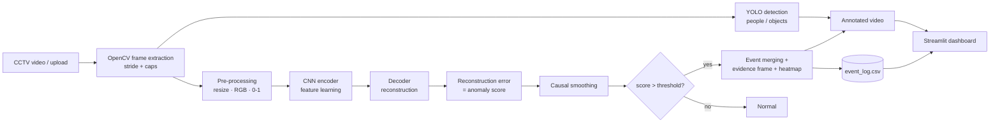
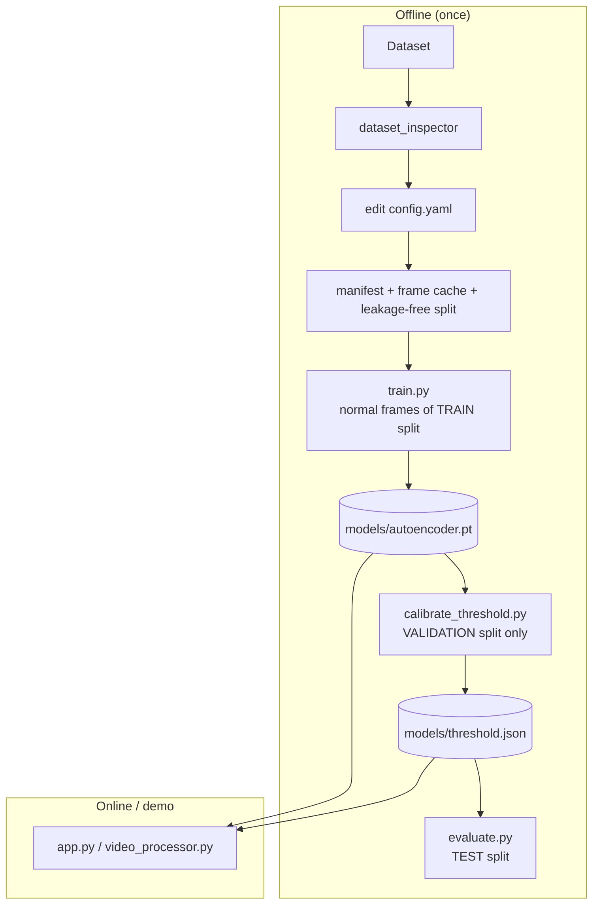

# AI CCTV Anomaly Detection System Using YOLO, CNN Autoencoder and Streamlit

BTech CSE project implementing **Milestone 2 – Project Design**: CCTV video → frame extraction → preprocessing →
YOLO person/object detection + CNN feature learning → reconstruction-based anomaly score → threshold → alert
(timestamp + evidence frame) → Streamlit dashboard, with evaluation.

---
## 0. Honest status (read first)

**Dataset (`cctvdataset/cctv-exam-monitor-dataset`) — UNCONFIRMED.** The Kaggle page could not be read automatically
(JavaScript-rendered; no file list was returned), so its folder structure, labels, formats and sample counts are **not
known to this project**. Nothing in the code assumes them. `src/dataset_inspector.py` reports what is really inside
once *you* download it; then you set the label mode in `config.yaml`.
Possible situations, all supported: (a) folders named like normal/abnormal → real metrics; (b) a label CSV you create
or obtain → real metrics; (c) no usable labels → normal-only training + qualitative results (accuracy/F1 are *not*
computed, because they would be invalid). Annotation files that only describe object boxes (e.g. YOLO `.txt`, COCO
JSON) are **not** normal/abnormal labels and are never treated as such.

**Verification status.**

| Part | Status |
|---|---|
| Preprocessing, frame extraction, labelling, leakage-free splits, dataset inspector, manifest/cache | ✅ executed and tested in my sandbox (synthetic fixture) |
| Video pipeline: batching, smoothing, event merging, evidence frames, annotated video (H.264 via ffmpeg), CSV logs | ✅ executed with a *stand-in scorer* (not the autoencoder) |
| 14 automated tests in `tests/test_preprocessing.py`, `tests/test_pipeline.py` | ✅ passed (run with a small pytest-emulating shim; install real pytest and re-run) |
| PyTorch autoencoder, `train.py`, `calibrate_threshold.py`, `evaluate.py`, `tests/test_autoencoder.py`, `tests/test_end_to_end_smoke.py` | ⚠️ **written but NOT executed** (PyTorch unavailable in my sandbox; only syntax-checked) |
| YOLO wrapper (Ultralytics) and Streamlit `app.py` | ⚠️ **written but NOT executed** (syntax-checked only) |
| Colab notebook | ⚠️ **not executed** |
| Real-dataset results | ❌ none exist. Everything in the report must come from your own runs. |

Run the smoke test (Section 4, step 8) first. If anything fails, copy the traceback and ask for a fix.

---
## 1. Architecture





### Model
Encoder: 4 × (Conv 4×4 stride 2 → BatchNorm → ReLU), channels 32-64-128-256, then Linear → 128-d latent. Decoder mirrors it
(ConvTranspose) with a final Sigmoid. Input 128×128×3 (configurable, multiple of 16). Loss: MSE. The architecture and
preprocessing settings are stored **inside the checkpoint**, and inference rebuilds the model from them, so training and
inference cannot disagree on tensor shapes or channels.
Score: `mse` (mean squared reconstruction error over the frame) or `topk` (mean of the worst 2% pixels, more sensitive to
small local changes but noisier). Scores are smoothed with a **causal** moving average (no future frames → real-time safe).

### Splits and leakage
Neighbouring video frames are almost identical, so a random frame split would leak and inflate results.
`split.strategy: auto` = **group split** (whole videos/folders go to one split, stratified by label) when ≥ 3 sources
exist, otherwise **temporal split** (first 70% of each timeline train, next 15% val, last 15% test). Threshold calibration uses
**validation only**; the test split is touched only by `evaluate.py`. Abnormal frames are never used for training.

---
## 2. Project structure
```
ai-cctv-anomaly-detection/
├── app.py                  Streamlit dashboard
├── config.yaml             all settings (dataset path, labels, model, thresholds, limits)
├── requirements.txt  .gitignore  .streamlit/config.toml
├── src/
│   ├── dataset_inspector.py   what is actually in the dataset
│   ├── preprocessing.py       frame extraction + the ONE preprocessing function
│   ├── dataset.py             manifest, label mapping, splits, torch Dataset
│   ├── yolo_detector.py       Ultralytics YOLO wrapper
│   ├── autoencoder.py         conv autoencoder, scores, checkpoint save/load
│   ├── train.py  calibrate_threshold.py  evaluate.py
│   ├── anomaly_detector.py    inference engine (loads model+threshold)
│   ├── video_processor.py     full video pipeline + CLI
│   ├── signal_utils.py        torch-free smoothing / heatmap helpers
│   ├── synthetic.py           SYNTHETIC test fixture (software testing only)
│   └── utils.py
├── tests/  notebooks/training_colab.ipynb  reports/report_template.md
└── data/  models/  outputs/   (see their READMEs)
```

---
## 3. Getting the dataset

Dataset: https://www.kaggle.com/datasets/cctvdataset/cctv-exam-monitor-dataset
Place it so the files end up (anywhere, recursively) under **`data/raw/cctv-exam-monitor-dataset/`** — this is the default
`paths.dataset_root`. If you use another folder, change `paths.dataset_root` in `config.yaml` (or pass `--root` to the inspector).

*Manual:* click **Download** on Kaggle, unzip into `data/raw/cctv-exam-monitor-dataset/`.
*CLI:* create a Kaggle API token (Kaggle → Settings → Create New Token → `kaggle.json`), then see commands below.

---
## 4. Commands

### 4A. Mac (Apple Silicon M2) terminal
```bash
# 1. Install
cd ai-cctv-anomaly-detection
python3 -m venv .venv && source .venv/bin/activate
pip install --upgrade pip && pip install -r requirements.txt
brew install ffmpeg                       # recommended: browser-playable annotated video
export PYTORCH_ENABLE_MPS_FALLBACK=1      # lets unsupported MPS ops fall back to CPU

# (dataset via CLI - or download manually as described above)
pip install kaggle && mkdir -p ~/.kaggle && mv ~/Downloads/kaggle.json ~/.kaggle/ && chmod 600 ~/.kaggle/kaggle.json
kaggle datasets download -d cctvdataset/cctv-exam-monitor-dataset -p data/raw/cctv-exam-monitor-dataset --unzip

# 8. Tests + software smoke test (synthetic fixture, no dataset needed) - DO THIS FIRST
python -m pytest -q tests
python -m src.train --synthetic && python -m src.calibrate_threshold --synthetic && python -m src.evaluate --synthetic

# 2. Inspect the real dataset, then edit config.yaml (label_mode, class names, labels_csv)
python -m src.dataset_inspector
# optional quick pipeline check on the REAL data (tiny):  python -m src.train --smoke

# 3. Train          4. Calibrate threshold          5. Evaluate
python -m src.train
python -m src.calibrate_threshold
python -m src.evaluate

# 6. Inference on a video (annotated video, CSVs, evidence frames -> outputs/inference/<name>/)
python -m src.video_processor --video path/to/cctv.mp4
python -m src.video_processor --video path/to/cctv.mp4 --no-yolo --threshold-multiplier 1.5

# 7. Dashboard
streamlit run app.py
```

### 4B. Google Colab (free GPU: Runtime → Change runtime type → T4 GPU)
Easiest: open `notebooks/training_colab.ipynb` (it does all of this). Manual equivalent, one cell each:
```python
# upload ai-cctv-anomaly-detection.zip via the Files panel, then:
!unzip -q -o ai-cctv-anomaly-detection.zip && cd ai-cctv-anomaly-detection && pip install -q -r requirements.txt
%cd /content/ai-cctv-anomaly-detection
```
```python
from google.colab import files; files.upload()          # choose kaggle.json
!mkdir -p ~/.kaggle && mv kaggle.json ~/.kaggle/ && chmod 600 ~/.kaggle/kaggle.json && pip install -q kaggle
!kaggle datasets download -d cctvdataset/cctv-exam-monitor-dataset -p data/raw/cctv-exam-monitor-dataset --unzip
```
```python
!python -m pytest -q tests                                # tests + synthetic smoke
!python -m src.train --synthetic && python -m src.calibrate_threshold --synthetic && python -m src.evaluate --synthetic
!python -m src.dataset_inspector                          # then edit config.yaml in the file browser
!python -m src.train && python -m src.calibrate_threshold && python -m src.evaluate
!python -m src.video_processor --video data/raw/cctv-exam-monitor-dataset/<some_video>.mp4
!zip -qr results.zip models outputs                       # then files.download('results.zip')
```
Restart the runtime if pip reports a NumPy/OpenCV binary mismatch. Run the dashboard on your Mac (copy `models/` from the zip).

---
## 5. Configuring labels (after inspecting)

| What the inspector shows | Set in `config.yaml` | Outcome |
|---|---|---|
| Folders like `normal/` and `abnormal/` (any names) | `label_mode: folders`, `normal_class_names: [...]`, `abnormal_class_names: [...]` (exact folder names) | Full metrics |
| A CSV of labels | `label_mode: csv`, `labels_csv: path.csv` with columns `path,label` (`path` relative to dataset root; optional `start_frame,end_frame` for abnormal segments) | Full metrics |
| Only object annotations / no labels | `label_mode: none`, `assume_unlabeled_normal: true` *only if* you believe the footage is mostly normal | Normal-only training; qualitative results; **no accuracy/F1** |

Honesty rule: if you train on unlabeled footage assumed normal, say so in the report.

---
## 6. Deviations from Milestone 2 (and why)
1. **CNN feature extraction + autoencoder are one network** (the autoencoder's encoder *is* the CNN feature extractor, trained from scratch on normal frames) rather than a separate pretrained CNN. Simpler, trainable on a free GPU, and a single clearly documented reconstruction-based model.
2. **Frame-level analysis** (the milestone allows "frames or short sequences"). Temporal context is limited to causal score smoothing; CNN-LSTM/Transformers remain Future Scope as in the milestone.
3. **YOLO is complementary**: it supplies people/object context and annotations, not the anomaly decision, and is never claimed to recognise abnormal behaviour.
4. **Metrics depend on labels**: milestone §5 plans classification metrics "for labeled events"; if the dataset has none, only score/error analysis is produced (also in the milestone: "anomaly score/error analysis where appropriate").
5. **Anomaly categories** (falling, fighting, …) are *not* claimed; the system flags "differs from learned normal", whatever that corresponds to in your data.

## 7. Limitations
Reconstruction error is not semantic: lighting changes or camera shake can raise it, and subtle abnormal actions (e.g. a head turn) may reconstruct as well as normal ones. Threshold quality depends on how representative the validation-normal frames are. Frame-level only. YOLO nano is fast but misses small/occluded objects. Results are specific to the dataset/camera. Alerts need human review.

## 8. What works immediately vs. what needs more
| Needs | Works |
|---|---|
| Only `pip install` | tests, synthetic smoke train/calibrate/evaluate, dashboard launch, inspector on any folder |
| Internet once (YOLO weights `yolov8n.pt`) | YOLO-only video analysis (`--no-anomaly`, dashboard "YOLO only") |
| Dataset download | real inspection, manifest, training |
| Training + calibration | anomaly scoring, alerts, evaluation, full dashboard |

## 9. Demonstration script (5–7 min)
1. Show `python -m src.dataset_inspector` output and explain label situation. 2. Show `training_curve.png` and `reconstruction_samples.png`. 3. Show `threshold_calibration.png` (why validation-only). 4. Show `outputs/evaluation/*` (or the no-labels explanation). 5. `streamlit run app.py`, upload a clip, run, show score timeline, annotated video, alert evidence + heatmap, CSV download. 6. Move the threshold multiplier to show the alert trade-off. 7. State limitations honestly.

## 10. Screenshots to capture (from your real run)
1) Inspector output · 2) `split_info.json` counts · 3) training log in terminal · 4) `training_curve.png` · 5) `reconstruction_samples.png` · 6) `threshold_calibration.png` · 7) `confusion_matrix.png` + `roc_pr_curves.png` (if labelled) · 8) `score_distribution.png` · 9) `highest_scoring_frames.png` · 10) Dashboard home with sidebar · 11) Dashboard after run: metrics + timeline · 12) Annotated video frame with ANOMALY banner + YOLO boxes · 13) Alerts tab with evidence + heatmap · 14) `event_log.csv` · 15) `pytest` passing.

## 11. Troubleshooting
| Symptom | Fix |
|---|---|
| `ModuleNotFoundError: src` | Run from the project root using `python -m src.xxx` / `streamlit run app.py` |
| `Dataset folder not found` | Check `paths.dataset_root`; unzip the Kaggle archive there |
| `No videos or images found` | Run the inspector; formats outside the supported list need converting (mp4/avi/mov/mkv; jpg/png) |
| `No NORMAL training frames` | Fix class names/label mode, or set `assume_unlabeled_normal: true` if appropriate |
| `No normal VALIDATION frames` | Provide ≥ 3 videos/folders or lower `split.train`; single videos use a temporal split |
| Test split has one class → no F1 | Expected; add labelled abnormal sources or report qualitatively |
| MPS error / slow on Mac | `export PYTORCH_ENABLE_MPS_FALLBACK=1`, or `--device cpu`; YOLO auto-falls back to CPU |
| CUDA out of memory (Colab) | lower `training.batch_size` or `data.image_size` |
| YOLO weights fail to download | Needs internet once; or place `yolov8n.pt` in the project root |
| Annotated video won't play in browser | Install ffmpeg (`brew install ffmpeg`); the file is still downloadable |
| Upload rejected as too large | Raise `app.max_upload_mb` **and** `.streamlit/config.toml` `maxUploadSize` |
| Everything flagged / nothing flagged | Adjust the threshold multiplier; recalibrate with another `percentile`; check `threshold_calibration.png` |
| Changed `score_method`/`smoothing_window` | Re-run `calibrate_threshold` (threshold is stored per scoring method) |
| Changed `image_size`/stride/labels | Re-train (cache and manifest rebuild automatically; `--rebuild-cache` forces it) |
| NumPy/OpenCV binary mismatch on Colab | Runtime → Restart session after `pip install` |

## 12. Tests
`python -m pytest -q tests` — preprocessing, labelling (exact folder-name match), split leakage, causal smoothing, video I/O errors, pipeline/event logic (stand-in scorer), autoencoder shapes/scores/checkpoints, and an end-to-end synthetic smoke test (PyTorch tests auto-skip without PyTorch). All test data is **synthetic** and is never a dataset result.

## 13. Academic integrity
Code is original and commented for understanding; be ready to explain every module. Report only numbers you generated (`reports/report_template.md` has placeholders). Outputs under `outputs/smoke/` and anything from `--synthetic` are software tests, not results.
